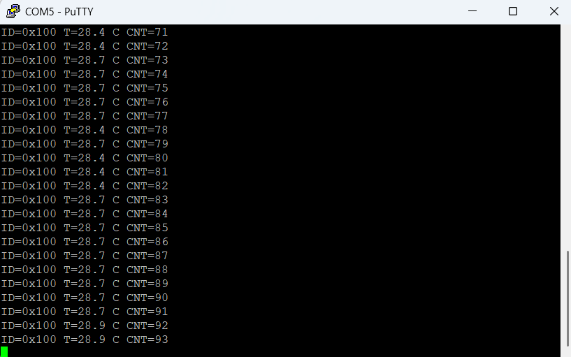
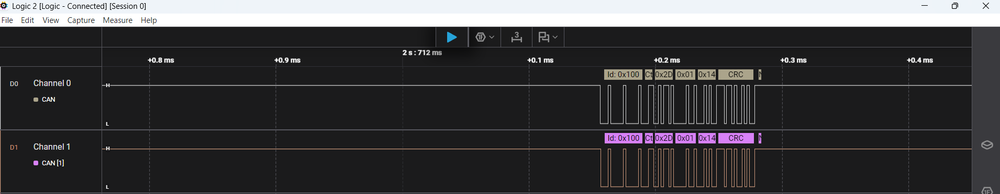

## Frame format

| CAN ID | DLC | Bytes 0-1                              | Byte 2        |
|--------|-----|----------------------------------------|---------------|
| 0x100  | 3   | Temperature in 0.1 °C, int16, little-endian | Frame counter |

## How to run
1. Wire both boards through CAN transceivers (CAN-H to CAN-H, CAN-L to CAN-L, 120 Ω at both ends, common GND).
2. Flash the L476 receiver first, open a serial terminal (115200 8N1).
3. Flash the F103 node. Expected output:
   `ID=0x100 T=30.1 C CNT=20`

## Status
- [x] CAN1 loopback test
- [x] F103 temperature node -> L476 receiver -> UART
- [ ] Listen-only (silent) mode
- [ ] SLCAN over USB CDC
## Hardware
- STM32L476RG 
- CAN transceiver SN65HVD230
- STM32F103C8T6
## Results

### Frame reception over CAN

*Temperature frames (ID `0x100`) sent by the F103 node and received by the L476.*

### CAN bus capture in Logic 2

*Logic 2 capture of the CAN bus in normal mode (500 kbit/s) while the F103 transmits its internal temperature.*
