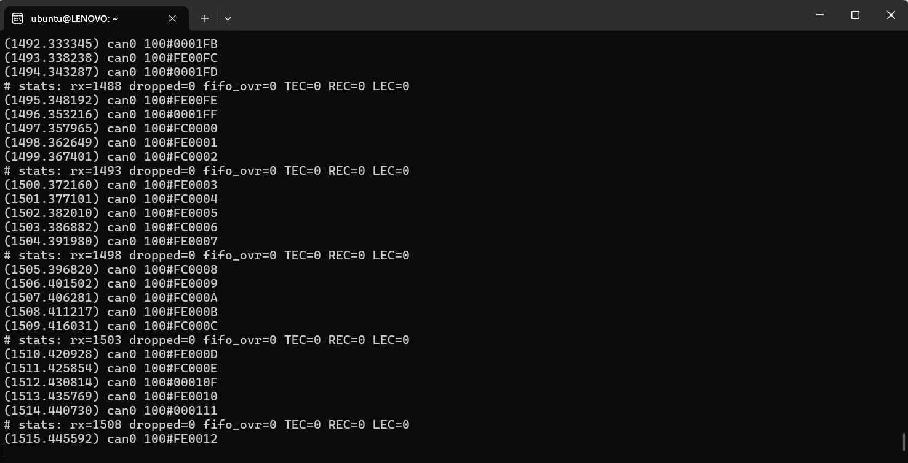
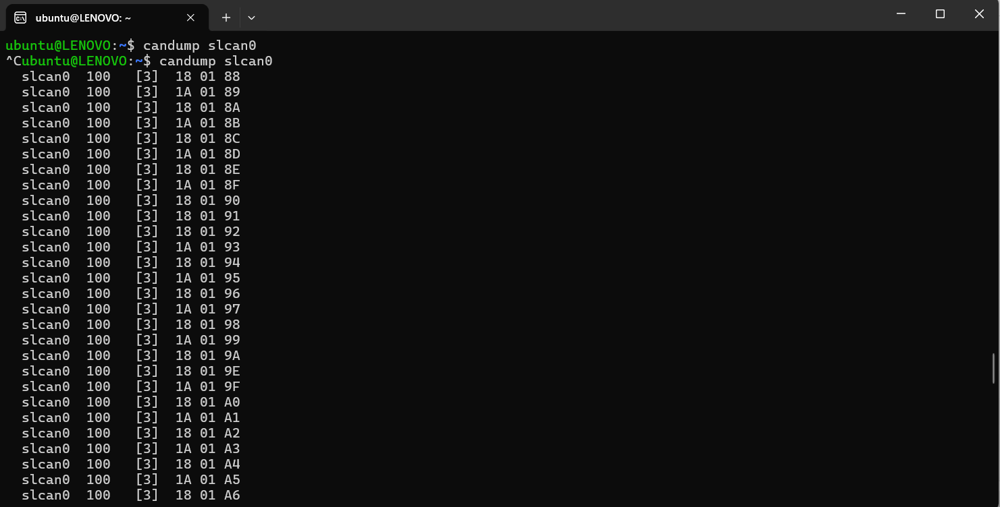

# STM32 CAN Bus Sniffer – Linux SocketCAN / SLCAN Adapter

AAn STM32-based device designed to connect to a vehicle's CAN bus and monitor CAN communication in real time. Implementing the LAWICEL/SLCAN protocol over UART, it allows Linux to recognize the device as a SocketCAN network interface, enabling CAN traffic analysis using standard Linux tools.

The project focuses on developing a low-cost, microcontroller-based automotive CAN bus sniffer that enables monitoring, capturing, and analyzing CAN frames exchanged between electronic control units (ECUs) in a vehicle.

## Features

- CAN communication using STM32 bxCAN peripherals.
- CAN frame reception and processing.
- LAWICEL/SLCAN protocol implementation over USART2.
- USB-to-UART communication with a Linux host.
- Linux SocketCAN integration through `slcand`.
- CAN frame monitoring using standard Linux CAN utilities.
- Support for standard and extended CAN frames.
- SLCAN command support:
  - `S` – Set CAN bitrate.
  - `O` – Open CAN channel.
  - `L` – Open CAN channel in listen-only mode.
  - `C` – Close CAN channel.
  - `t`, `T` – Transmit standard/extended CAN frames.
  - `r`, `R` – Transmit standard/extended RTR frames.
  - `F` – Read status flags.
  - `V` – Read firmware version.
  - `N` – Read serial number.
  - `Z0` – Disable timestamp output.

## Hardware

- STM32L476RG – CAN receiver / sniffer.
- STM32F103C8T6 – CAN transmitter node.
- SN65HVD230 CAN transceivers.
- USB-to-UART interface connected to USART2.
- CAN bus with 120 Ω termination resistors.

## System Architecture

```text
       STM32F103C8T6
       CAN transmitter
              |
              |
       SN65HVD230
              |
              |
      CAN BUS (500 kbit/s)
              |
              |
       SN65HVD230
              |
              |
       STM32L476RG
       CAN sniffer
              |
           USART2
              |
       USB-to-UART
              |
              |
        Ubuntu Linux
              |
           slcand
              |
           slcan0
              |
        SocketCAN
              |
      +-------+-------+
      |       |       |
  candump  cansend  canplayer
```

## CAN Frame Format

The current test application uses CAN identifier `0x100` to transmit temperature measurements.

| CAN ID | DLC | Data bytes | Description |
|:---:|:---:|---|---|
| `0x100` | 3 | Bytes 0–1 | Temperature in 0.1 °C, signed int16, little-endian |
| `0x100` | 3 | Byte 2 | Frame counter |

## Linux SocketCAN Integration

The STM32 sniffer implements the LAWICEL/SLCAN serial protocol, allowing Linux to expose it as a SocketCAN interface.

### 1. Install required tools

```bash
sudo apt update
sudo apt install can-utils
```

### 2. Connect the device

Connect the STM32 sniffer to the Linux host through the USB-to-UART interface.

Check the serial device:

```bash
ls -l /dev/ttyUSB*
```

### 3. Create the SocketCAN interface

Start `slcand`:

```bash
sudo slcand -o -s6 -t hw -S 3000000 /dev/ttyUSB0 slcan0
```

Bring the interface up:

```bash
sudo ip link set slcan0 up
```

Configuration:

| Option | Description |
|---|---|
| `-o` | Open CAN channel |
| `-s6` | Set CAN bitrate to 500 kbit/s |
| `-t hw` | Use hardware timestamps |
| `-S 3000000` | Set serial communication speed to 3 Mbaud |
| `/dev/ttyUSB0` | Serial device |
| `slcan0` | SocketCAN interface name |

### 4. Monitor CAN traffic

Display received frames:

```bash
candump slcan0
```

Display frames with absolute timestamps:

```bash
candump -ta slcan0
```

Inspect the interface:

```bash
ip -details link show slcan0
```

### 5. Additional SocketCAN tools

Once `slcan0` is active, standard Linux CAN utilities can interact with the device.

Examples:

```bash
candump slcan0
```

```bash
cansend slcan0 100#2D0114
```

```bash
cangen slcan0
```

**Note:** Transmitting CAN frames requires the STM32 firmware to support the corresponding SLCAN transmit commands and forward them to the CAN controller.

## How to Run – Bench Test

1. Connect both STM32 boards through SN65HVD230 CAN transceivers.
2. Connect CAN-H to CAN-H and CAN-L to CAN-L.
3. Install 120 Ω termination resistors at both ends of the CAN bus.
4. Connect the sniffer's USB-to-UART interface to the Linux host.
5. Flash the STM32L476RG sniffer firmware.
6. Flash the STM32F103C8T6 transmitter firmware.
7. Start `slcand` and bring `slcan0` up.
8. Run:

```bash
candump -ta slcan0
```

The F103 transmitter periodically sends temperature frames with CAN ID `0x100`. The L476 sniffer receives these frames and forwards them to Linux using the LAWICEL/SLCAN protocol.

## Results

### v0.1 – CAN Receiver and UART Output

Initial implementation of CAN communication between STM32F103C8T6 and STM32L476RG.

The F103 node transmits temperature frames. The L476 receives frames through the CAN Rx FIFO0 interrupt, queues the data, and prints decoded temperature values over USART2.

**Commit:** [Add CAN receiver: forward temperature frames from F103 to UART](https://github.com/trangonameless/stm32-can-bus-sniffer/commit/6d63ee9c2e18dd89a16671d2a281efd4c4d69970)


*Temperature frames transmitted by the F103 node and received by the L476 receiver.*

### CAN Bus Capture – Logic 2

Logic analyzer capture of CAN traffic in normal mode at 500 kbit/s while the F103 node transmits its internal temperature.


*CAN bus signals captured using Logic 2.*

### v0.2 – CAN Sniffer with candump-Compatible Output

The next development stage introduced CAN frame monitoring through the STM32 sniffer, forwarding received frames to Ubuntu in a candump-compatible text format.



*CAN frames received in Ubuntu through the serial interface.*

### Current Version – LAWICEL/SLCAN and SocketCAN Integration

The latest implementation introduces the LAWICEL/SLCAN protocol over USART2.

Using `slcand`, Linux creates a SocketCAN network interface named `slcan0`. This allows the STM32 sniffer to work with standard Linux CAN utilities without requiring a custom serial logging application.



*CAN frames received in Ubuntu through the `slcan0` interface using `candump -ta`.*

## Project Status

- [x] STM32 bxCAN initialization and loopback testing.
- [x] CAN communication between STM32F103C8T6 and STM32L476RG.
- [x] Temperature frame transmission and reception.
- [x] CAN bus monitoring using a logic analyzer.
- [x] CAN sniffer with candump-compatible output.
- [x] LAWICEL/SLCAN protocol implementation over USART2.
- [x] Linux integration using `slcand`.
- [x] SocketCAN interface creation (`slcan0`).
- [x] CAN frame reception in Ubuntu using `candump`.
- [ ] Vehicle CAN bus testing.

## Technologies

- STM32 HAL
- bxCAN
- C
- UART / USART
- USB-to-UART
- LAWICEL / SLCAN
- Linux SocketCAN
- `can-utils`
- Ubuntu Linux
- Logic 2 (Saleae)
